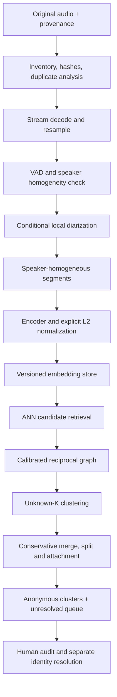

# VoiceID

**Дослідницька база знань і технічна специфікація для масштабного виявлення та ідентифікації мовців у неоднорідному аудіокорпусі.**

VoiceID досліджує задачу **Large-Scale Open-World Speaker Discovery and Identification**: як знайти повторювані голоси серед великої кількості записів, коли число людей невідоме, надійних міток немає, а мова, канал і якість змінюються.

Цільовий масштаб у поточній специфікації — приблизно **3 ТБ аудіо** російською, українською, суржиком і з перемиканням мов. Запланований обчислювальний бюджет — **4 × NVIDIA RTX 4090 та NVIDIA DGX Spark**. Фактичний склад корпусу й пропускна здатність потребують інвентаризації та вимірювання.

> **Статус: research / pre-implementation.** У цьому репозиторії є wiki, першоджерела, master specification, експортні матеріали NotebookLM та технічні аудити. Production pipeline, VoiceEvolve, trusted evaluator і власні відтворювані ML-бенчмарки тут ще не реалізовані.

## З чого почати

| Матеріал | Для чого читати |
| :-- | :-- |
| [Детальний аудит 2026-10-14](wiki/concepts/project-audit-2026-10-14.md) | Поточна зрілість, підтверджені помилки, методологічні ризики, бюджет пам'яті та пріоритети |
| [Генеральний огляд](wiki/overview.md) | Постановка задачі та задум системи |
| [Master Technical Context](docs/VOICE_ID_OPENEVOLVE_MASTER.md) | Повна архітектурна специфікація VoiceID + VoiceEvolve + OpenEvolve |
| [Каталог wiki](wiki/index.md) | Навігація по моделях, поняттях, датасетах і джерелах |
| [Відкриті питання](wiki/open-questions.md) | Блокери, невизначеності й суперечності |
| [Журнал](wiki/log.md) | Історія досліджень, інтеграції джерел та аудиту |

Для нового читача рекомендований порядок: **цей README → детальний аудит → overview → потрібні розділи master → тематичні сторінки**. Аудит пояснює, які старі рекомендації ще потребують узгодження.

## Яку задачу вирішує VoiceID

У цільовому корпусі можуть бути:

- невідомі та повторювані мовці;
- кілька голосів усередині одного запису;
- короткі фрази, шум, музика та перекриття мовлення;
- різні телефони, мікрофони, кодеки й частоти дискретизації;
- одна людина, яка говорить різними мовами або звучить по-різному в різних сесіях;
- дублікати, пересилання й перекодовані копії.

Очікуваний первинний результат — **анонімні групи голосів** на кшталт `Speaker_000001`, із доказами походження, оцінкою якості та історією рішень. Пов'язування з реальною особою є окремим етапом і потребує підтвердженого reference voice чи інших перевірених доказів.

| Задача | Питання |
| :-- | :-- |
| Voice activity detection | Де є мовлення? |
| Local diarization | Хто говорить коли в одному записі? |
| Speaker verification | Чи належать два фрагменти одному мовцю? |
| Global speaker discovery | Які записи в усьому корпусі належать одному мовцю? |
| Open-set identification | Чи відповідає новий голос відомому кластеру, чи він невідомий? |
| Identity resolution | Чи є достатні докази зв'язку кластера з конкретною особою? |

ASR відповідає на питання «що сказано», а anti-spoofing — «чи є голос синтезованим». Вони не замінюють speaker discovery.

## Основні принципи

1. **False merge значно дорожчий за false split.** Чисті фрагменти однієї людини можна об'єднати пізніше; хибне злиття різних людей забруднює рішення.
2. **Unknown-K.** Production-алгоритм не отримує істинну кількість мовців як параметр. Known-K допускається тільки для діагностичного oracle control.
3. **`speaker_cluster_id != person_id`.** Акустична група сама по собі не встановлює особу.
4. **Abstention є нормальним результатом.** `OUTLIER` і `UNRESOLVED` потрібні для контролю невизначеності.
5. **Первинні докази незмінні; похідні дані версіоновані.** Новий encoder створює новий embedding snapshot.
6. **Рішення мають lineage.** Merge, split, attachment та identity links повинні бути простежуваними й оборотними.
7. **Якість встановлює незалежний evaluator.** LLM пропонує кандидати та пояснення, але не підміняє ground truth або метрики.

## Запланований production pipeline

Наведена схема описує цільову архітектуру; її модулі ще не реалізовані в цьому репозиторії.



### Три шари даних

| Шар | Вміст | Цільова політика |
| :-- | :-- | :-- |
| Raw evidence | Original audio, hash, URI, provenance | Immutable |
| Derived evidence | VAD, segments, embeddings, quality metadata | Versioned / append-only |
| Decision state | Membership, merge/split, identity evidence | Versioned events та rollback |

Для векторів master пропонує binary/Arrow shards; PostgreSQL — для metadata, state, lineage й offsets; Parquet — для manifests та аналітики. Це архітектурні рішення, а не вже розгорнутий storage stack.

## VoiceID, VoiceEvolve та OpenEvolve

| Назва | Запланована роль |
| :-- | :-- |
| **VoiceID** | Виробничий конвеєр обробки аудіо та підтримки анонімних кластерів |
| **VoiceEvolve** | Дослідницька платформа: experiment manifests, ізоляція, trusted evaluator, gates та історія кандидатів |
| **OpenEvolve** | Зовнішній рушій еволюції обмежених фрагментів алгоритмічного коду |

Перший дослідницький рівень — **backend на frozen embeddings**. Це дозволяє порівнювати graph/scoring/merge logic без повторного neural inference для кожної мутації.

Можливі цілі еволюції: edge scoring, adaptive-k, edge acceptance, merge policy, split detector, outlier attachment і prototype builder. Першу кампанію доцільно обмежити одним `build_edges` із фіксованими даними, кластеризатором і метриками.

Числове tuning, code evolution та навчання encoder мають різні експериментальні бюджети. У master їх відокремлено: **Level A — backend; Level B — training recipe; зміни архітектури — пізніше**.

Докладніше: [OpenEvolve/VoiceEvolve](wiki/concepts/openevolve.md), [аудит інтеграції](wiki/concepts/project-audit-2026-10-14.md#12-openevolvevoiceevolve-корисний-другий-етап).

## Моделі та майбутній benchmark

Поточна специфікація використовує **ReDimNet2-B6 як baseline** та **B3 як efficiency tier**. Це стартові кандидати, а не доведені переможці на цільових даних.

До дослідницького порівняння входять ERes2NetV2, CAM++, SimAM-ResNet та контрольні системи. Вибір checkpoint має враховувати upstream version, training dataset, frontend, output dimension, normalization та measured cost.

Заявлені EER з різних статей не формують прямий рейтинг для RU/UA/Surzhyk corpus. Остаточний encoder потрібно обирати за **downstream false merges, false splits, coverage, hard slices та compute**, а не лише за VoxCeleb EER.

| Матеріал | Зміст |
| :-- | :-- |
| [Каталог моделей](wiki/models/comparison.md) | Історичні порівняння та шортлісти; читати разом з аудитом |
| [ReDimNet2](wiki/models/redimnet2.md) | Локальний опис baseline |
| [Перевірка upstream](wiki/sources/lit-2026-10-14-audit-upstream.md) | Уточнення output dimension, normalization та технічних властивостей |
| [Короткі записи](wiki/concepts/short-duration.md) | Залежність результату від тривалості |
| [Domain mismatch](wiki/concepts/domain-mismatch.md) | Контекст перенесення між умовами; частина числових висновків уточнена аудитом |

## Оцінювання та критерії безпеки

Ціль — збільшувати корисне охоплення **в межах заздалегідь визначеного false-merge risk**. Одного ARI, NMI чи EER недостатньо.

Майбутній evaluator має розділяти:

- pairwise precision/recall та їхні complements;
- false-positive rate на негативних trials;
- помилки прийняття ребер і merge events;
- impurity, contamination та fragmentation кінцевих clusters;
- coverage, singletons, unresolved і voiced-duration coverage;
- якість на cross-session, cross-language, коротких і телефонних записах;
- confidence bounds, runtime, RAM/VRAM та graph size.

У master `FMR = FP/(TP+FP)` означає complement pair precision; це інший denominator, ніж `FPR = FP/(FP+TN)`. Формула `SafeCoverage`, numeric safety limits і noise policy ще потребують формалізації.

Заплановані benchmark partitions: `TRAIN`, `SEARCH-DEV`, `SHADOW-DEV`, `HIDDEN-TEST`, `FINAL-BLIND`. Потрібні speaker-disjoint splits і перевірка session/content/duplicate leakage. Candidate code не повинен отримувати приховані labels або змінювати evaluator.

Поточні документи: [протокол](wiki/experiments/protocol.md), [пілот](wiki/experiments/clustering-pilot.md), [методологічний аудит](wiki/concepts/project-audit-2026-10-14.md#7-калібрація-й-safety-найважливіші-методологічні-виправлення).

## Основні результати аудиту 2026-10-14

| Знахідка | Практичний наслідок |
| :-- | :-- |
| 2 ТБ/старий шортліст та 3 ТБ/ReDimNet2 співіснують у документації | Потрібно явно визначити current і historical context |
| «×9 domain degradation» порівнює рецепти з різними training sets | Ці числа не доводять чистий transfer effect одного checkpoint |
| 9,141% у WeSpeaker PDF помилково приписано SpeechBrain | Треба виправити атрибуцію та похідні рейтинги |
| Перевірений B6 recipe має 192 dimensions; `forward` не робить явного L2-normalize | Конкретні checkpoint/schema/frontend слід перевірити перед extraction |
| Split-half не гарантує одного мовця | Потрібні speaker-homogeneous positives і незалежний cross-session контроль |
| Random negatives легші за ANN impostors | Калібрація має відповідати retrieval policy |
| 200 boundary pairs не доводять наднизьку популяційну помилку | Потрібні репрезентативні trials та confidence bounds |
| Старий RAM-бюджет рахує vectors як index | ANN, graph і temporary memory рахуються окремо |
| Kaggle-ноутбук вирішує anti-spoofing | Його метрики не є speaker-identification results |

Приклад capacity calculation з аудиту: **30 млн FP16-векторів по 192 dimensions + directed graph k=200 ≈ 59,76 GB**, ще без ANN index, edge features і робочих копій. Це сценарний розрахунок, не виміряний production footprint.

Детальний аудит містить докази, контрприклади, розрахунки та 12 проблем стороннього ноутбука. Старі матеріали збережено для простежуваності; їхні твердження ще не всі виправлено. Додатковий [попередній огляд узгодженості](wiki/project-audit.md) також збережено як окремий документ.

## Структура репозиторію

```text
VoiceID/
├── README.md                         # Публічний вступ і навігація
├── CLAUDE.md                         # Правила підтримки LLM Wiki
├── docs/                             # Первинні джерела та master specification
│   ├── VOICE_ID_OPENEVOLVE_MASTER.md
│   ├── *.pdf
│   ├── *.md
│   └── *.ipynb
├── wiki/
│   ├── index.md                      # Каталог
│   ├── overview.md                   # Синтез
│   ├── master-context.md             # Копія master specification
│   ├── open-questions.md             # Блокери й прогалини
│   ├── log.md                        # Append-only історія
│   ├── project-audit.md              # Огляд узгодженості
│   ├── concepts/                     # Поняття, методи, детальний аудит
│   ├── models/                       # Моделі та порівняння
│   ├── datasets/                     # Датасети й стратегія корпусу
│   ├── sources/                      # Конспекти й provenance
│   └── experiments/                  # Плани й протоколи
└── notebooklm/
    ├── README.md                     # Навігатор експортного пакета
    ├── 00_*.md ... 09_*.md            # Тематичні досьє
    └── reports/                      # Звіти, JSON/CSV та infographic; audio overview у GitHub Release
```

`temp/`, checkpoint files, embeddings і experiment runs виключені через `.gitignore`. Згенерований NotebookLM audio overview поширюється окремим GitHub Release asset, щоб уникнути повільного клонування історії. Приватний аудіокорпус і model weights у цей snapshot не входять.

## Як користуватися репозиторієм

### Читання на GitHub

Почніть із таблиці «З чого почати». README використовує звичайні Markdown links. Усередині wiki застосовані Obsidian-посилання `[[slug]]`; GitHub відображає їх як текст.

### Локально

```bash
git clone https://github.com/cyberdid/VoiceID.git
cd VoiceID
```

Відкрийте `wiki/` як vault в Obsidian для навігації через wikilinks. Для читання також достатньо будь-якого Markdown-редактора. PDF і notebook залишаються первинними джерелами; ноутбук не є готовою командою запуску VoiceID.

**Installation/run command для production service поки немає:** executable implementation і dependency manifest ще не додані.

### Для дослідників та агентів

Прочитайте [CLAUDE.md](CLAUDE.md) перед змінами. Основний workflow:

1. Почати з `wiki/index.md` та релевантних сторінок.
2. Зіставити твердження з першоджерелом і зафіксувати умови вимірювання.
3. Новий синтез зберегти у wiki; додати його до каталогу й журналу.
4. Позначати published result, власний reproduced result, hypothesis та unverified claim окремо.
5. Не змінювати й не видаляти raw sources у `docs/` без прямої вказівки.

Для власного експерименту потрібні hypothesis, dataset manifest/hash, code/config/checkpoint versions, seed, predictions, metrics із denominators та висновок. Формат: `wiki/experiments/YYYY-MM-DD-<slug>.md`.

## NotebookLM

Пакет [notebooklm/](notebooklm/README.md) містить тематичні досьє та згенеровані артефакти. Він є похідним експортом бази знань, а не незалежною ground truth.

Під час синтезу частина невизначених тверджень отримала надмірну впевненість; це описано в аудиті. Досьє 00–08 також зберігають попередню стратегію для 2 ТБ. Статус зовнішнього хмарного блокнота не перевірявся під час цього аудиту чи публікації.

## Дорожня карта

| Етап | Очікуваний результат |
| :-- | :-- |
| Узгодження документації | Чинний baseline, corpus scope, provenance та historical pages |
| Inventory | Реальні години, формати, число сегментів, duplicate/quality distributions |
| Eval foundation | Trusted metrics, annotation protocol, незалежні splits і numeric gates |
| Encoder smoke | Pinned checkpoint/frontend та versioned embedding snapshot |
| Малий end-to-end пілот | Audio → clusters, quality/coverage/cost та audit samples |
| Backend comparison | HDBSCAN, AHC і graph families на однакових inputs |
| Scale/incremental | Peak-memory budget, crash recovery, lineage, rollback і shadow rebuild |
| OpenEvolve v1 | Один bounded target та budget-matched незалежна перевірка |
| Encoder adaptation | Pseudo-label training після стабілізації якості clusters |

**Перший milestone:** відтворюваний запуск на реальному аудіо, що повертає анонімні кластери та показує перевірювані quality, coverage і resource cost. Календарні оцінки master є планом; підтвердженого completion schedule немає.

## Як долучитися

Корисні напрями: уточнення джерел, формалізація evaluator, inventory/manifest tooling, pinned inference adapters, memory benchmarks, hard-negative evaluation та reproducible baseline experiments.

Для пропозиції чи результату додайте:

- конкретну проблему або спростовну гіпотезу;
- посилання на зачеплені документи чи першоджерело;
- точні data/model/protocol conditions;
- метод перевірки та фактичні результати, якщо був прогін;
- межі висновку й наступний крок.

Не подавати сторонні published metrics або AI-generated summaries як власні результати VoiceID.

## Джерела та ліцензування

Основні зовнішні проєкти: [ReDimNet2](https://github.com/PalabraAI/redimnet2), [WeSpeaker](https://github.com/wenet-e2e/wespeaker), [3D-Speaker](https://github.com/modelscope/3D-Speaker), [OpenEvolve](https://github.com/algorithmicsuperintelligence/openevolve), [FAISS](https://github.com/facebookresearch/faiss).

Бібліографічні конспекти та умови експериментів зібрано в [wiki/sources/](wiki/sources/). Первинні PDF: [WeSpeaker](docs/2210.17016v2.pdf) та [VoxWatch](docs/2307.00169v1.pdf).

Окремий файл `LICENSE` для власних матеріалів цього репозиторію поки не додано. Сторонні статті, checkpoints і datasets мають власні умови, які не визначаються публічністю цього репозиторію.

---

Документальний snapshot: **2026-10-14**. Поточні обмеження та пріоритети — у [детальному аудиті](wiki/concepts/project-audit-2026-10-14.md) і [реєстрі питань](wiki/open-questions.md).
